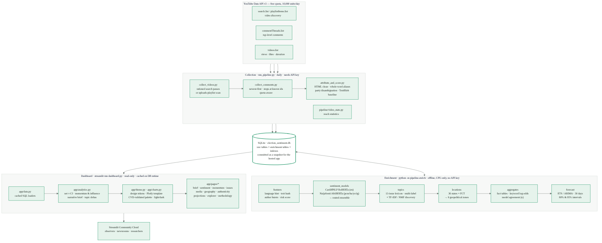

# Nigeria 2027 Election Intelligence Platform

Public-comment intelligence for Nigeria's 16 January 2027 presidential election, built from YouTube
comments on 50 Nigerian news, radio, vernacular-language and civic channels. Tracks the three leading
contenders — Atiku Abubakar (ADC), Peter Obi (NDC) and Bola Ahmed Tinubu (APC) — with transformer
sentiment, issue tagging, composite momentum/influence indices, authenticity signals, conversation
geography and 30-day projections, all on a free, open-source stack.

Live app: https://nigeria2027electionsentimentanalysis.streamlit.app/

> **What it is / isn't.** It measures the conversation under the news on YouTube. It is not a poll, not a
> forecast of the result, and every number inherits the limitations listed on the Methodology page.

## Architecture



Three independent layers share one SQLite file:

| Layer | Entry point | Runs where | Needs |
|---|---|---|---|
| **Collection** | `python run_pipeline.py` | daily, on the collection host | `YOUTUBE_API_KEY` |
| **Enrichment** | `python -m pipeline.enrich` (also called by `run_pipeline.py`) | same host, after collection, CPU-only | PyTorch CPU + transformers (`requirements-pipeline.txt`) |
| **Dashboard** | `streamlit run dashboard.py` | Streamlit Community Cloud (or anywhere) | `requirements.txt` only — it never runs a model |

The dashboard reads pre-aggregated **fact tables** (`fact_daily`, `fact_daily_topic`, `fact_daily_location`,
`keyword_stats`, `forecasts`, …) and only touches comment rows in the explorer, through parameterised SQL with
`LIMIT`. That design is what keeps every page under a second and lets the same app serve 1M+ comments on a
free tier. See [`docs/ARCHITECTURE.md`](docs/ARCHITECTURE.md).

## Quick start

```bash
# 1. Environment (Python 3.11–3.13 recommended for PyTorch wheels)
python -m venv venv && source venv/bin/activate          # Windows: venv\Scripts\activate
pip install torch --index-url https://download.pytorch.org/whl/cpu
pip install -r requirements-pipeline.txt

# 2. Collection (free YouTube Data API v3 key — see "API key" below)
export YOUTUBE_API_KEY=...                                 # Windows: set YOUTUBE_API_KEY=...
python resolve_channels.py                                # once, and whenever config.CHANNELS changes
python run_pipeline.py                                    # discovery → comments → attribution → enrichment

# 3. Dashboard
streamlit run dashboard.py
```

Upgrading an existing database created by the original pipeline? Run `python -m pipeline.enrich` once
(≈1 h for 40k comments on two CPU cores; minutes per day afterwards). It adds tables, never alters or
drops the original ones, detects the legacy attribution and re-attributes automatically.

### Daily schedule

```cron
30 23 * * * cd /path/to/nigeria_election_sentiment && /path/to/venv/bin/python run_pipeline.py >> pipeline.log 2>&1
```

`run_daily_pipeline.sh` / `.bat` wrap the same command and load `.env`. Add `--no-enrich` to collect only.

### Deploying the dashboard

Streamlit Community Cloud installs `requirements.txt` and runs `dashboard.py`. The database is committed to
the repository as a snapshot (`election_sentiment.db`) so the hosted app has data; after each pipeline run,
commit the refreshed file and push — the app reloads automatically. Keep the hosting repository private if
you consider the raw comments sensitive. `.streamlit/config.toml` carries the light and dark themes.

GitHub rejects files above 100 MB. The enriched database is ~70 MB at 40k comments and grows roughly 1.7 MB per
1,000 comments. When it approaches the limit, publish a slim copy for hosting and point the app at it:

```bash
python -m pipeline.publish --models routed textblob     # -> election_sentiment.app.db (~47 MB today)
# commit election_sentiment.app.db and set DB_PATH=election_sentiment.app.db in the Streamlit Cloud secrets/env
```

### API key

1. console.cloud.google.com → create a project → enable *YouTube Data API v3* → Credentials → API key.
2. `cp .env.example .env` and set `YOUTUBE_API_KEY`, or export it in the environment.
3. Free quota is 10,000 units/day. `search.list` costs 100 units, `commentThreads.list` and `videos.list` 1 unit.

## Repository layout

```
dashboard.py                 Streamlit entry point (st.navigation)
app/
  theme.py                   design tokens, CSS, Plotly template (light + dark)
  data.py                    cached read-only loaders, explorer SQL
  analytics.py               net sentiment + CI, momentum/influence indices, narrative brief
  charts.py                  Plotly builders (dataviz rules: one axis, fixed colours, masked small cells)
  components.py              page header, stat tiles, scorecards, badges, table twins
  state.py                   global sidebar controls → Filters
  pages/                     overview · sentiment · momentum · topics · media · geography ·
                             authenticity · projections · explorer · methodology
  assets/nigeria_states.geojson  geoBoundaries ADM1, CC BY 4.0, simplified
pipeline/
  settings.py                constants shared by pipeline and app (no API key)
  schema.py                  additive DDL + indexes
  features.py                language hint, duplicate hashes, author bursts, risk score
  sentiment_models.py        CardiffNLP RoBERTa + NaijaSenti AfriBERTa → routed ensemble
  topics.py                  13-issue lexicon (multi-label) + TF-IDF/NMF discovery
  locations.py               36 states + FCT, 6 geopolitical zones
  video_stats.py             views/likes per video (reach)
  aggregates.py              fact tables, weighted log-odds keywords, model agreement
  forecast.py                ETS/ARIMA projections with intervals
  enrich.py                  orchestrator
config.py, db.py, collect_videos.py, collect_comments.py, attribute_and_score.py, resolve_channels.py,
run_pipeline.py              collection layer (original scripts, upgraded)
pipeline/publish.py          slim copy of the database for hosting (drops raw text, optional per-model rows)
docs/                        ARCHITECTURE.md · IMPROVEMENT_REPORT.md · ROADMAP.md · architecture.png/svg
tests/                       pytest unit tests for analytics, attribution, features, topics, locations
tools/                       headless page tests, interaction tests, performance timing, screenshots
```

## Configuration highlights (`config.py`, `pipeline/settings.py`)

* `DISCOVERY_MODE` — `search` (default; original behaviour, 100 units per channel × query) or `uploads`
  (walk each channel's uploads playlist, ~100 units for the whole roster, every day). Switch via environment
  variable once validated against a live key.
* `MAX_SEARCH_CALLS_PER_RUN` — 50 (5,000 units), leaving ~5,000 units for comments and statistics.
* `MAX_COMMENTS_PER_VIDEO` — per-video cap per run; the collector stops paging when it reaches comments it already holds.
* `DEFAULT_MODEL` — `routed` (CardiffNLP for English, NaijaSenti for Pidgin/Hausa/Yoruba/Igbo).
* `TOPICS`, `STATE_ALIASES`, `LANG_MARKERS` — auditable lexicons; every tag in the app can be traced to a term here.
* `MATURITY_DAYS` — days after the last fetch treated as "still accumulating" (excluded from trends/indices/projections).
* `MIN_N_FOR_RATE` — cells with fewer observations are masked.

## Data model (additions)

| Table | Grain | Purpose |
|---|---|---|
| `comment_sentiment` | comment × model | label, confidence, class probabilities; models `cardiffnlp`, `naijasenti`, `routed`, `textblob` |
| `comment_features` | comment | language hint, text hash, duplicate counts, author activity, risk score, flag |
| `comment_topics` | comment × topic × method | lexicon (multi-label) and NMF dominant theme |
| `discovered_themes` | theme × rank | top terms per NMF theme |
| `comment_locations` | comment × state | states / zones the comment mentions |
| `video_stats` | video | views, likes, comment count, duration |
| `fact_daily` | day × candidate × channel × model | counts by label, likes, authors, flagged, videos |
| `fact_daily_topic`, `fact_daily_location` | day × candidate × topic/state × model | counts by label |
| `keyword_stats` | candidate × polarity × model × rank | weighted log-odds terms (positive, negative, emerging) |
| `forecasts` | candidate × model × metric × day | 30-day projections with 80/95% intervals |
| `model_agreement` | model pair | agreement rate and Cohen's κ |
| `enrichment_runs` | run | step, rows written, parameters |

Indexes on `comments(video_id, published_at, author)`, `videos(channel_id)` and the enrichment tables were
added; the original schema had none beyond primary keys.

## Testing

```bash
pip install -r requirements-dev.txt
pytest -q                     # analytics, attribution, features, topics, locations
```

Each page also runs headlessly with Streamlit's `AppTest` (`python tools/apptest_pages.py`, and
`python tools/apptest_interactions.py` for filter combinations); `python tools/perf.py` reports cold/warm render
times; the visual QA used `tools/screenshot.py` with headless Chrome at desktop, tablet and phone widths in both
colour schemes.

## Methodology, limitations and roadmap

* In-app: the **Methodology & data** page (sources, attribution rules, models and their agreement, index
  formulas, authenticity heuristics, projections, limitations, downloads, annotation-sample export).
* [`docs/IMPROVEMENT_REPORT.md`](docs/IMPROVEMENT_REPORT.md) — what changed, why, expected impact.
* [`docs/ROADMAP.md`](docs/ROADMAP.md) — prioritised next steps.

## Licence and attribution

Code: MIT. Map boundaries: geoBoundaries (gbOpen) ADM1, CC BY 4.0. Models: CardiffNLP
`twitter-roberta-base-sentiment-latest` (MIT) and `Davlan/naija-twitter-sentiment-afriberta-large`
(NaijaSenti, CC BY 4.0 data / open weights). Comments are public YouTube data; only display names are stored
and they are masked in the interface.
