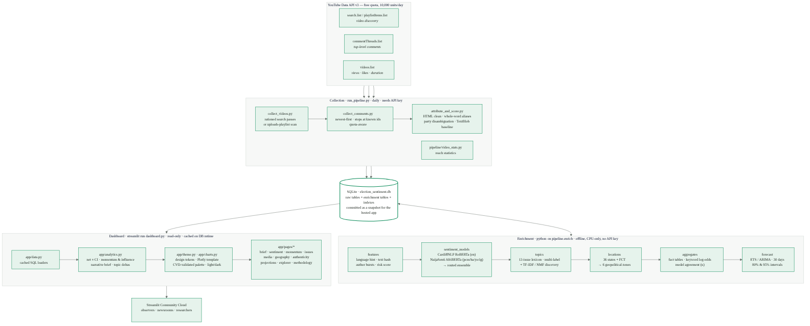
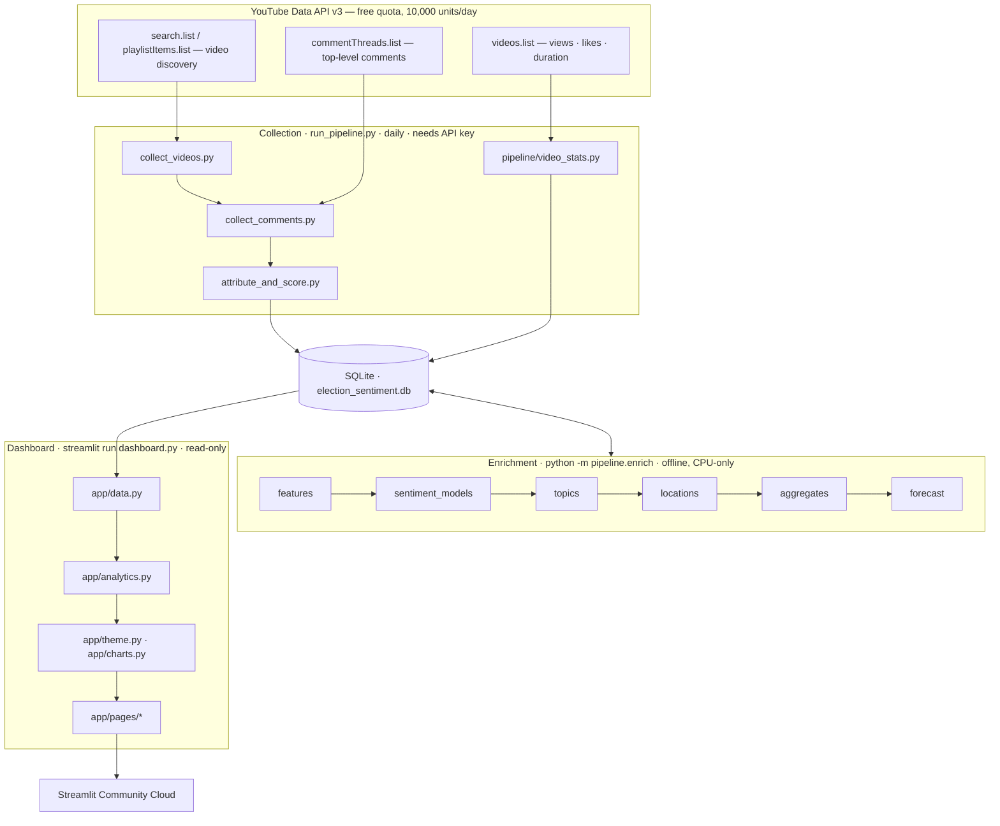

# Architecture

*(Source: [`architecture.mmd`](architecture.mmd) — Mermaid; GitHub renders it inline below. `architecture.svg` is the vector version.)*

## Design principles

1. **Compute offline, render online.** Transformer inference, topic modelling, keyword statistics and
   forecasting run in `pipeline/enrich.py` on the collection host and write results to SQLite. The Streamlit app
   never imports PyTorch, scikit-learn or statsmodels. This is the only way a research-grade NLP stack fits a
   free hosting tier with ~1 GB of RAM and a cold-start budget of seconds.
2. **Fact tables, not comment scans.** `fact_daily` has one row per (day, candidate, channel, model). Its size is
   bounded by the calendar and the roster — about 4k rows today, ~100k at a million comments — so every chart is a
   `groupby` over a few thousand rows regardless of corpus size. Comment-level access is confined to the explorer,
   which uses parameterised SQL with `LIMIT` and the new indexes.
3. **Additive, idempotent, resumable.** Every enrichment table is `CREATE IF NOT EXISTS`; scoring only touches
   comments without a row for that model; fact tables are rebuilt in full (seconds) so they can never drift. A
   crash loses at most one batch.
4. **One source of truth for constants.** `pipeline/settings.py` holds candidates, lexicons, thresholds and model
   ids for both the pipeline and the app, and has no API-key dependency. `config.py` keeps collection settings and
   exposes the key through `require_api_key()` instead of raising at import time.
5. **Every number is auditable.** Model id and timestamp on every score; run log per step; lexicons listed in the
   app; alias and topic cues highlighted per comment in the explorer; table twin + CSV behind every chart.

## Data flow

| Step | Reads | Writes | Cost |
|---|---|---|---|
| `collect_videos` | API | `videos`, `discovery_state` | 100 units per channel × query (search) or ~2 units per channel (uploads) |
| `collect_comments` | API, `videos`, `video_fetch_state` | `comments`, `video_fetch_state` | 1 unit per 100 comments; newest videos first; stops at known ids |
| `attribute_and_score` | `comments` | `text_clean`, baseline sentiment, `comment_candidate_mentions`, `comment_party_mentions` | ms per comment |
| `pipeline.features` | `comments` | `comment_features` | ~7 s / 40k |
| `pipeline.sentiment_models` | `comments`, `comment_features` | `comment_sentiment` (4 models) | ~20–45 comments/s/core; incremental |
| `pipeline.topics` | `comments` | `comment_topics`, `discovered_themes` | ~15 s / 40k |
| `pipeline.locations` | `comments` | `comment_locations` | ~2 s / 40k |
| `pipeline.video_stats` | API, `videos` | `video_stats` | 1 unit per 50 videos |
| `pipeline.aggregates` | all of the above | `fact_daily*`, `keyword_stats`, `model_agreement` | ~3 s |
| `pipeline.forecast` | `fact_daily` | `forecasts` | ~2 s |
| dashboard | fact tables, dims; comments via explorer | — | < 1 s per page after cache warm-up |

## Runtime topology

* **Collection host** — the user's Windows machine today (`run_daily_pipeline.bat`), or a small Linux VM /
  container (`Dockerfile`, `azure-setup.sh`). Needs the API key and the pipeline requirements. Produces the
  database file.
* **Hosting** — Streamlit Community Cloud pulls the GitHub repository, installs `requirements.txt`, runs
  `dashboard.py`. The database is committed as a snapshot; pushing a refreshed file redeploys. Caches are keyed
  on the file's mtime/size, so no manual cache clearing is needed.
* **Browser** — Plotly renders client-side; payloads are small because only aggregates are shipped
  (the state GeoJSON is 140 KB, cached).

## Scaling notes

| Corpus | fact_daily rows | app memory | explorer query | enrichment increment |
|---|---|---|---|---|
| 40k comments (today) | ~4k | ~150 MB | < 50 ms | minutes |
| 500k | ~50k | ~200 MB | < 200 ms with indexes | ~1 h/day on 2 cores if 20k new comments/day |
| 1M+ | ~100k | ~250 MB | < 300 ms | consider batching scoring across the day or a GPU |

The only component that grows with comment volume *inside the app* is the explorer's `COUNT(*)`, which uses the
indexes on `comments(published_at)`, `comment_candidate_mentions(candidate, comment_id)` and
`comment_sentiment(model, label)`.

## Security and privacy

* The API key never enters the repository: `.env` and `.claude/settings.local.json` are git-ignored; `config.py`
  no longer fails at import without a key, so the dashboard has zero exposure to it.
* The app opens SQLite in read-only mode (`mode=ro`, `PRAGMA query_only`) and all explorer queries are parameterised.
* Only public comment text, like counts and the public display name are stored; display names are masked in the UI
  and dropped from CSV exports.
* `enableXsrfProtection` is on; no file uploads are accepted.
